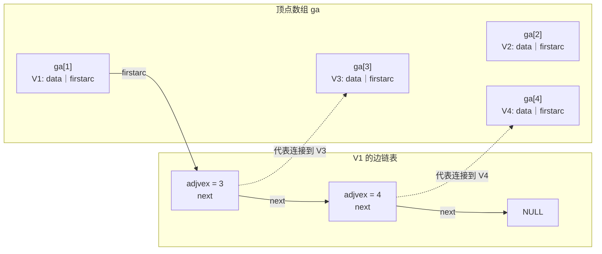
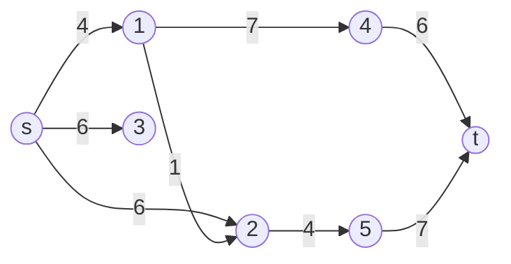

# 基础
G=<V,E>
V:vertex点集   G:graph边集合
子图：V，E是子集
弧：有向图的边   
有向图 $0 \le e \le n(n-1)$ 即$C_{n}^2$   
无向图 $0 \le e \le n(n-1)/2$
完全图：e最大   
v的度TD=ID+OD,$e=\frac12 \sum TD(v_i)$   
路径，简单路径   
回路、环,简单环      
无向图中，连通图、连通分量；有向图中，强连通图：任意两个点之间都有路径
- 强连通：任意两点互相可达
- 单向连通：任意两点至少一个方向可达
- 弱连通：把所有弧改成无向边后才连通
# 存储
关联矩阵
有向图A[i,j]=1,i与j边相连且i为尾；0，ij不相连；-1，i顶点与j相连   
A ───────────▶ B   
(弧尾 tail)      (弧头 head)   
i的OD为第i行1的个数，ID为-1个数
无向图A[i,j]=1，i与j相连；0，i与j不相连。
### 邻接表

```c
#define M 10
typedef struct Node{
  int adjvex;      //邻接点的标号，弧头所指
  struct Node*next;//指示下一条弧
}GraphNode;
//边的链表

typedef struct TableNode{
  int vexdata;//顶点信息
  struct TableNode*firstarc;//第一个邻接点的边
}Graph;
//点的链表

void addEdge(Graph ga[],int from,int to ){
  GraphNode* newNode=(GraphNode*)malloc(sizeof(GraphNode));
  newNode->adjvex=to;
  newNode->next=ga[from].firstarc;
  ga[from].firstarc=newNode;
  //头插法，如A->B,加上from a ，to c。A的firstarc是指向B，新的C的next指向A的firstarc（B），更新A的firstarc为C。的则A->C->B
}//添加有向边

Graph ga[M];//顶点数组,ga[0]不用
for(int i=1;i<=4;++i){
  ga[i].vexdata=i;
  ga[i].firstarc=NULL;
}
```
### 十字链表

```mermaid
%%{init: {
  "theme": "base",
  "themeVariables": {
    "primaryTextColor": "#1a1a1a",
    "secondaryTextColor": "#1a1a1a",
    "tertiaryTextColor": "#1a1a1a",
    "textColor": "#1a1a1a",
    "lineColor": "#455a64",
    "fontSize": "15px"
  }
}}%%
flowchart TD
    classDef vertex fill:#e1f5fe,stroke:#0288d1,stroke-width:2px,color:#0d1b2a;
    classDef edge fill:#fff3e0,stroke:#f57c00,stroke-width:2px,color:#3e2723;

    subgraph V_Array ["顶点数组 DirectGraph g"]
        V1["g&#91;1&#93; · A0<br/>data &#124; firstin &#124; firstout"]:::vertex
        V2["g&#91;2&#93; · A1<br/>data &#124; firstin &#124; firstout"]:::vertex
        V3["g&#91;3&#93; · A2<br/>data &#124; firstin &#124; firstout"]:::vertex
        V4["g&#91;4&#93; · A3<br/>data &#124; firstin &#124; firstout"]:::vertex
    end

    subgraph E_Nodes ["弧结点 边"]
        E6["边6<br/>tailvex=1, headvex=4<br/>hlink &#124; tlink"]:::edge
        E3["边3<br/>tailvex=1, headvex=3<br/>hlink &#124; tlink"]:::edge
        E1["边1<br/>tailvex=1, headvex=2<br/>hlink &#124; tlink"]:::edge
        E2["边2<br/>tailvex=3, headvex=1<br/>hlink &#124; tlink"]:::edge
        E5["边5<br/>tailvex=2, headvex=3<br/>hlink &#124; tlink"]:::edge
    end

    V1 -- firstout --> E6
    E6 -- tlink --> E3
    E3 -- tlink --> E1

    V3 -- firstin --> E5
    E5 -- hlink --> E3

    V1 -- firstin --> E2
    E2 -- hlink --> E1

    E6 -.->|实际指向顶点4| V4
    E3 -.->|实际指向顶点3| V3
    E1 -.->|实际指向顶点2| V2
```

```cpp
typedef struct arcnode
{   int      tailvex,  headvex;  //弧尾、弧头在表头数组中位置
    struct   arcnode   *hlink；  //指向弧头相同的下一条弧，入度
    struct   arcnode   *tlink;   //指向弧尾相同的下一条弧，出度
}DirectGraphEdge;
typedef  struct  dnode
{   int      data;  //存与顶点有关信息
    struct   arcnode   *firstin；//指向以该顶点为弧头的第一个弧结点
    struct   arcnode   *firstout; //指向以该顶点为弧尾的第一个弧结点
}DirectGraph;
```
### 无向图的邻接多重表示法
```cpp
typedef   struct  node
{   int  mark;   //标志域
     int  ivex, jvex;  //该边依附的两个顶点在表头数组中位置
     struct  node   *ilink,  *jlink;  //分别指向依附于ivex和jvex的下一条边
}NonGraphNode;
typedef   struct  dnode
{    int   data;   //存与顶点有关的信息
      struct   node  *firstedge;  //指向第一条依附于该顶点的边
}NonGraph;

```
## 深度优先树DFS
## 广度优先树BFS

# 最短路径
### dijkstra
- 1初始化： dist[s]=0,邻接点dist[v]=value,其它dist[v]=inf，表示到s的距离，S={s}
- 2从未确定最短路径的顶点找到dist最短的点u并加入S S={u}+S
- 3根据u更新v的dist[v]
- 4如果其中的v有 $dist[u]+dist[uv] \le dist[v]$ 则记录u为v前驱
- 5重复2-3到所有顶点使U为空 S=V

|S | U | dist|pre|
|-|-|-|-|
|{s}|{1,2,3,4,5,t}|{0,4,6,6,inf,inf,inf}|[-,s,s,s,-,-,-]|
|{s,1`}|{2,3,4,5,t}|{0,4,5,6,11,inf,inf}|[-,s,**1**,s,**1**,-,-]|
|{s,1,2`}|{3,4,5,t}|{0,4,5,6,11,9,inf}|[-, s, 1, s, 1, **2**, -]|
|{s,1,2,3`}|{4,5,t}|{0,4,5,6,11,9,inf}|[-, s, 1, s, 1, 2, -]|
|{s,1,2,3,5`}|{4,t}|{0,4,5,6,11,9,17}|[-, s, 1, s, 1, 2, **5**]|
|{s,1,3,4,5,4`}|{t}|{0,4,5,6,11,9,16}|[-, s, 1, s, 1, 2, 5]|
|{s,1,2,3,4,5,t`}|{}|{0,4,5,6,11,9,16}|[-, s, 1, s, 1, 2, 5]|     

根据前驱表[-,s,1,s,1,2,5]   
如s到t:t<-5<-2<-1<-1   
s到4:4<-1<-s   
最后对点u,有dist(u)，找前驱：u的前驱中各个v的 $dist(v)+dist(uv) \le dist(u)$则u当做前驱,不断重复得到路径

邻接表 + 二叉堆优先队列：
O((V+E)logV)
邻接表
O()
### floyd
邻接矩阵与path矩阵，path矩阵存有向边的前驱。
# 最小生成树
### prim
### kruskal
边权重排序
选代价最小的边

# 拓扑排序  
### AOV(activity on vertex Network)
- AOV网中选一个无前驱（ID=0）的输出
- 删去这个顶点以及出发的所有有向边
- 重复上述
如果还有点没删除，则AOV中有有向回路（环）   
### AOE(activity on edge Network)   
关键路径：耗时最长，决定最短工期,关键事件点连起来
关键活动：不能拖延，开始时间与最晚时间一样   
点（事件）最早晚ve,vl;边（活动）的最早晚e,l   
$ve(j)=\max\{ve(i)+w(\langle i,j\rangle)\}$      
$vl(j)=\min\{ve(i)-w(\langle i,j\rangle)\}$   
$e(i)=ve(i)$      
$l(i)=vl(v_)-w$   
