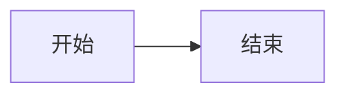

# 页面修改手册

这份手册对应当前仓库。修改页面时，先运行 `npm run dev`，在浏览器打开终端显示的本地地址；保存文件后页面会自动刷新。改完再运行 `npm run build` 检查。

## 常用文件

| 想改什么 | 文件 |
| --- | --- |
| 文章摘要卡片的颜色 | `src/styles/custom.css` |
| 全站背景、侧栏、按钮、间距与圆角 | `src/styles/global.css` |
| 顶栏、左右侧栏、导航文字与图标 | `src/layouts/SiteLayout.astro` |
| 首页 | `src/pages/index.astro` |
| 文章分类文件夹索引页 | `src/pages/posts/index.astro` |
| 站内搜索页与搜索范围 | `src/pages/search/index.astro` |
| 分类及嵌套文件夹页 | `src/pages/category/[...path].astro` |
| 文章正文页和上一篇／下一篇 | `src/pages/posts/[...id].astro` |
| 作者姓名、简介、头像 | `src/site.config.ts` |
| 右侧阅读日历界面与同步逻辑 | `src/components/ReadingCalendar.astro` |
| Google OAuth Web Client ID | `src/calendar.config.ts` |
| 文章 | `src/content/posts/*.md` |
| 右侧任务清单 | `src/content/tasks/**/*.md`、`src/components/TaskList.astro` |

## 改文章摘要卡片

直接编辑 `src/styles/custom.css`。目前深色模式的摘要卡片是：

```css
:root:not([data-theme='light']) {
  --summary-background: #303134;
  --summary-text: #e8eaed;
}

:root:not([data-theme='light']) .post-card,
:root:not([data-theme='light']) .article-row {
  background: var(--summary-background);
  color: var(--summary-text);
  border: 0;
}
```

`--summary-background` 是卡片面颜色，`--summary-text` 是卡片文字颜色。`border: 0` 表示没有边框线。`.post-card` 用于首页和全部文章页，`.article-row` 用于分类页。只想修改其中一种卡片时，可以把对应的选择器拆成单独规则。

如果要单独设置浅色模式的摘要卡片，可在文件末尾添加：

```css
:root[data-theme='light'] .post-card,
:root[data-theme='light'] .article-row {
  background: #ffffff;
  color: #202124;
  border: 0;
}
```

## 改全站配色

`src/styles/global.css` 开头的 `:root` 定义深色模式；紧接着的 `:root[data-theme=light]` 定义浅色模式。常用变量如下：


| 变量 | 控制的位置 |
| --- | --- |
| `--bg` | 页面背景 |
| `--surface` | 左右侧栏与空状态背景 |
| `--surface-high` | 次级按钮和进度条底色 |
| `--primary` | 强调色、链接、选中按钮 |
| `--text`、`--muted` | 主要文字、次要文字 |
| `--line` | 顶栏、侧栏和正文分隔线 |

不想改动原文件时，也可以在 `src/styles/custom.css` 末尾覆盖变量。例如：

```css
:root:not([data-theme='light']) {
  --bg: #202124;
  --surface: #202124;
  --primary: #8ab4f8;
}
```

`custom.css` 在 `global.css` 之后加载，适合放自己的覆盖样式。修改背景、卡片和文字颜色后，分别检查深色与浅色模式，确认文字仍然清楚。

首页两侧的竖线和顶部横线也在 `custom.css` 中关闭，对应 `.rail-left`、`.rail-right` 和 `.topbar`。如需重新显示其中一条线，可以把相应的 `border-*: 0` 改为 `1px solid var(--line)`。

## 改文字、导航和图标

页面顶部与左右侧栏写在 `src/layouts/SiteLayout.astro`。搜索页面上看到的文字即可找到对应位置。图标使用 Material Symbols，代码例如：

```html
<span class="material-symbols-outlined" aria-hidden="true">description</span>
```

把 `description` 改为其他 Material Symbols 图标名称即可。字体文件已放在 `src/assets/fonts/`，网站运行时不需要从 Google Fonts 下载图标。

作者资料在 `src/site.config.ts` 中填写；三个字段全为空时，左侧不显示作者资料。`avatar` 可填图片的完整 HTTPS 地址。

## 添加右侧任务清单

把 Markdown 文件放进 `src/content/tasks/`，可以使用子文件夹。网站构建时自动读取，右侧日历下方按文件展示内容；不用在网页上上传，也不需要文章的日期和分类信息。文件名默认作为清单标题；如需自定标题，可在文件顶部添加 `title`：

```md
---
title: 本周任务
---

- [ ] 阅读一篇文章
- [x] 整理笔记
```

网页上的任务清单按 Markdown 原文展示；要更新勾选状态，修改文件中的 `[ ]` 或 `[x]` 后重新构建网站。

## 写和发布文章

可以直接写正文并保存为 `src/content/posts/` 中的 Markdown 文件，例如 `my-note.md`。运行 `npm run dev` 时，新文件会自动补入以下顶部信息；`npm run build` 也会检查并补齐没有顶部信息的文件。填写标题、摘要、日期和分类后，把 `draft` 改为 `false` 即可发布。

```md
---
title: 我的文章
description: 文章摘要
date: 2026-11-18
category: 笔记
tags: [写作]
draft: false
---

## 第一节

正文内容。
```

如果把文章放在 `src/content/posts/数据结构与算法/`，分类会自动设为 `数据结构与算法`，并覆盖该文件顶部原有的 `category` 值；更深层的子文件夹仍使用 `posts` 下第一层文件夹名作为文章分类。文件夹索引则按实际目录逐层显示，例如 `posts/数据结构与算法/动态规划/矩阵连乘.md` 会显示为“文章 → 数据结构与算法 → 动态规划 → 矩阵连乘”。放在 `posts` 根目录的文章继续手填 `category`，并显示在该分类下。`draft: false` 才会出现在网站上；二级和三级标题会进入文章目录。同一文件夹的上一篇／下一篇按 `date` 排序。文章文件名和文件夹名会成为网址的一部分。

左侧导航只显示“首页”和“文章”。打开“文章”先看到顶层文件夹；进入文件夹后显示下一层子文件夹和本层文章。尚无已发布文章的文件夹不会出现在索引中。

正文中的 Markdown 代码块会在网站上显示复制按钮。写法例如：

````md
```js
console.log('hello');
```
````

行内公式写 `$E=mc^2$`，独立公式用两行 `$$` 包住；Mermaid 图使用 `mermaid` 代码块。例如：

````md
$$
E=mc^2
$$


````

Mermaid 图在网页展示时自动使用网站的明暗主题。图内的 `init`、主题配置、`classDef`、`style` 和 `linkStyle` 等局部样式会在构建时忽略，节点与连线结构会保留；原 Markdown 文件不会被改写。

## 检查与上传

```bash
npm ci
npm run dev
npm run build
```

首次安装依赖运行 `npm ci`，以后改页面通常只需 `npm run dev` 和 `npm run build`。构建结果在 `dist/`。将代码推送到 GitHub 的 `main` 或 `master` 分支后，仓库内的 GitHub Actions 工作流会重新构建网站；`dist/` 不需要手动上传。

## 配置 Google 日历同步

阅读日历在浏览器中授权，每位访客连接自己的 Google 账号。所选日历中的全部活动和重复活动实例会显示在月历及当日时间轴；新增、修改和删除会立即调用 Google Calendar API 写回。编辑或删除一个重复活动实例只影响该次活动。全天和跨天活动显示在对应日期。其他设备更改后，可以点击右栏的同步图标，或切回博客窗口刷新。短期访问令牌暂存在当前标签页的 `sessionStorage`，用于跨博客页面恢复连接；不会写入仓库，也不保存刷新令牌。主动断开、令牌过期或关闭标签页后需要重新连接。

点击右侧小日历中的日期，会打开按小时排列的当日安排。上方可切换前一天、后一天或返回今天；点击活动可编辑，点击“活动”可添加。编辑表单可设置全天及跨天日期。左上角返回按钮回到原页面；切换页面或刷新后，在访问令牌有效期内会自动恢复连接。

1. 在 [Google Cloud Console](https://console.cloud.google.com/) 创建项目，启用 **Google Calendar API**。
2. 配置 OAuth 同意屏幕，创建类型为 **Web application** 的 OAuth Client ID。测试阶段将自己的 Google 账号加入测试用户；面向公众开放时，Google 可能要求对日历读写权限完成应用验证。
3. 在 **Authorized JavaScript origins** 添加本地 `http://localhost:4321`，以及部署域名 `https://<用户名>.github.io`。如果使用自定义域名，也添加其 HTTPS 来源。来源只包含协议和域名，不包含仓库路径。
4. Web Client ID 已写入 `src/calendar.config.ts`。默认写入当前账号的主日历；如果已有单独的阅读日历，可复制 `.env.example` 为 `.env`，把 `PUBLIC_GOOGLE_CALENDAR_ID` 改为该日历 ID。
5. 推送代码后重新部署。若想从 GitHub 仓库设置覆盖配置，可在 **Settings → Secrets and variables → Actions → Variables** 中添加 `GOOGLE_CLIENT_ID`，需要指定日历时再添加 `GOOGLE_CALENDAR_ID`。

配置示例：

```env
PUBLIC_GOOGLE_CLIENT_ID=可选：用于覆盖代码中的Web Client ID
PUBLIC_GOOGLE_CALENDAR_ID=primary
```

Web Client ID 是公开标识，站点构建后访客可以看到；**不要**把 Google Client Secret 放入仓库或 `.env`。当前授权范围为 `calendar.events`，Google 将其描述为可以查看和编辑账号日历中的事件。模块会读取所选日历中的全部活动，也允许编辑或删除它们；请使用单独的阅读日历 ID 限定操作范围（`PUBLIC_GOOGLE_CALENDAR_ID`）。若访问令牌到期，点击“连接 Google 日历”重新授权。
